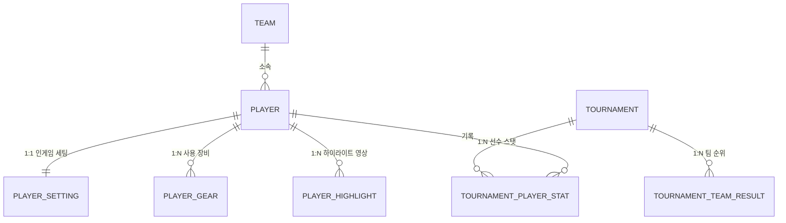

# 🎮 PUBG PRO VAULT — 프로젝트 상세 분석 및 설명서

> **배틀그라운드(PUBG) eSports 프로 선수 정보, 인게임 세팅, 장비 아카이브 및 Twire.gg 스타일 대회 통계 플랫폼**

---

## 📌 1. 프로젝트 개요 & 목적

- **프로젝트명**: `PUBG PRO VAULT` (PUBG eSports Analytics & Player Gear Archive)
- **주요 목적**:
  1. 배틀그라운드 프로 선수들의 **상세 프로필, 인게임 감도(DPI/일반/ADS/수직 배율/FOV), 사용 장비(마우스, 패드, 키보드, 모니터 등), 하이라이트 영상**을 아카이빙하고 검색할 수 있는 환경 제공
  2. 글로벌 PUBG eSports 통계 플랫폼인 **Twire.gg 스타일의 대회 종합 순위표(Leaderboard) 및 선수별 킬/딜량/Twire Rating 스탯 랭킹** 제공
  3. 외부 사이트(ProSettings, Wiki 등)로부터 최신 데이터를 수집할 수 있는 **웹 크롤러 및 스케줄러 엔진** 내장

---

## 🏗️ 2. 시스템 아키텍처 및 기술 스택

```mermaid
graph TD
    User([사용자 웹 브라우저]) -->|HTTP / REST API| Frontend[React 18 + Vite Web App]
    Frontend -->|JSON API 호출 :8080| Backend[Spring Boot 3.2.3 REST API]
    Backend -->|Spring Data JPA| Database[(PostgreSQL 16 DB :5432)]
    Backend -->|Jsoup Web Crawler| ExternalSites[외부 웹사이트 / ProSettings]
    Backend -->|@Scheduled 매일 새벽 4시| BatchEngine[데이터 자동 최신화 배치]
```

### 🛠️ 백엔드 (Backend)
- **언어 및 프레임워크**: Java 17, Spring Boot 3.2.3
- **ORM / 데이터베이스**: Spring Data JPA, Hibernate, PostgreSQL 16 (로컬 H2 호환)
- **웹 크롤링 & HTML 파싱**: Jsoup 1.17.2
- **배치 & 스케줄링**: Spring `@EnableScheduling` 및 `@Scheduled` (매일 새벽 4시 자동 크롤링)
- **기타 라이브러리**: Lombok, Spring Web (CORS 설정 완료)

### 🎨 프론트엔드 (Frontend)
- **프레임워크 / 번들러**: React 18, Vite 5
- **아이콘 라이브러리**: `lucide-react`
- **디자인 시스템**: e스포츠 게이밍 감성의 **다크 & 골드 네온 글래스모피즘(Glassmorphism) 테마** (`index.css`)
- **프록시 & 통신**: Vite Proxy 설정으로 `/api` 요청을 백엔드(`http://localhost:8080`)로 자동 라우팅하며, 백엔드 오프라인 시에도 UI가 동작하도록 `mockData.js` 기반의 폴백 시스템 내장

### 🐳 인프라 및 DB 관리
- `docker-compose.yml`: PostgreSQL 16 Alpine 컨테이너를 구동하여 즉시 사용할 수 있도록 구성

---

## 🗄️ 3. 데이터베이스 모델 설계 (ERD)

선수(`Player`)와 대회(`Tournament`)를 중심으로 데이터가 체계적으로 연결되어 있습니다.



1. **Player (선수 기본 정보)**:
   - 닉네임, 본명, 포지션(IGL, Main Attacker 등), 국적, 프로필 이미지 URL
   - 방송 플랫폼 링크 (유튜브, 네이버 치지직, SOOP/아프리카TV)
   - 크롤링 최신화 타임스탬프(`lastCrawledAt`), 현역 여부(`isActive`)
2. **PlayerSetting (인게임 세팅)**:
   - 마우스 DPI, 일반 감도, 조준 감도, ADS 스코프 감도, 배율별 감도(2x~8x), 수직 감도 배율, 1인칭 시야각(FOV), 해상도(예: 1728x1080, 1920x1080), 렌더링 크기 등
3. **PlayerGear (사용 기어)**:
   - 카테고리 (MOUSE, MOUSEPAD, KEYBOARD, HEADSET, EARPHONE, MONITOR), 장비 모델명, 브랜드, 구매 링크
4. **PlayerHighlight (대회 하이라이트)**:
   - 영상 제목, 유튜브 임베드 URL, 대회명
5. **Team (소속 팀)**:
   - 팀명, 소속 지역(KR, APAC, EMEA, AMER 등), 팀 로고 URL
6. **Tournament & TournamentTeamResult**:
   - 대회 기본 정보(티어, 상금 규모, 개최지, 일정, 진행 상태) 및 팀별 종합 순위표(치킨 수, 킬 포인트, 순위 포인트, 총점, 획득 상금)
7. **TournamentPlayerStat (선수별 대회 스탯)**:
   - Kills, Damage, Knocks(기절), Assists, 헤드샷 비율(%), 평균 생존 시간, Twire Rating

---

## 🖥️ 4. 주요 구현 기능 및 화면 구성

### ① PRO PLAYERS 탭 (`PlayerView.jsx`)
- **실시간 검색**: 선수 닉네임, 본명, 사용 중인 마우스 모델명으로 실시간 검색 가능
- **팀별 필터링**: ALL, KWANGDONG FREECS, Gen.G, Danawa e-sports, Soniqs 등 팀별 즉시 필터링
- **선수 카드 그리드**: 선수 사진, 소속팀 뱃지, 포지션, 주요 감도/DPI 스펙 및 마우스 정보를 카드로 한눈에 확인
- **선수 상세 모달 (`PlayerDetailModal.jsx`)**:
  - 카드 클릭 시 오픈되는 상세 팝업
  - 방송 플랫폼(치지직/SOOP/유튜브) 바로가기 버튼 및 검증 뱃지
  - **인게임 세팅 테이블**: DPI, 감도, 수직 배율, FOV, 해상도 및 **자동 계산된 eDPI 게이지** 시각화
  - **기어 랙 (Gear Rack)**: 마우스/패드/키보드/헤드셋/모니터 등 카테고리별 장비 모델 표시
  - **하이라이트 영상 플레이어**: 유튜브 임베드 영상 즉시 재생

### ② TOURNAMENTS 탭 (`TournamentView.jsx`)
- **대회 전환 배너**: 대회(PGS 4 등)의 상금 규모, 개최지, 기간, 티어 정보 표시
- **Twire.gg 스타일 종합 순위표**: 1~3위 금/은/동 하이라이트, SUPER 룰셋 기준 순위(Rank), 팀명, 지역, WWCD(치킨 수), 킬 포인트, 순위 포인트, 토탈 점수, 상금 테이블 제공

### ③ LEADERBOARD 탭 (`StatsView.jsx`)
- **MVP 하이라이트 카드**: 대회 최다 킬/딜량 1위 선수(Top Fragger)와 최고 Twire Rating 강조
- **선수 개인 스탯 랭킹표**: 순위, 선수명, 소속팀, Kills, Damage, Knocks, Assists, 헤드샷 %, Twire Rating 정렬 표시

### ④ LIVE DATA CRAWLER 패널 (`CrawlerPanel.jsx`)
- 상단 네비게이션의 `DATA CRAWLER` 버튼을 누르면 열리는 관리 패널
- 전체 선수 데이터 일괄 최신화 및 특정 선수 닉네임 입력 기반 개별 크롤링 트리거
- 크롤링 진행 상황을 터미널 형식의 로그로 실시간 확인 가능

---

## ⚡ 5. 백엔드 핵심 로직 & 데이터 초기화

1. **초기 시드 데이터 자동 주입 (`DataInitializer.java`)**:
   - 서버 기동 시 DB가 비어 있으면 한국 및 글로벌 주요 프로팀(광동 프릭스, 젠지, 다나와, 소닉스, 트위스티드 마인즈 등 8개 팀)과 유명 프로선수(**Seoul 조기열, Salute 우제현, Inonix 나희주, Heaven 김태성, TGLTN**)의 실제 세팅/장비 데이터 및 PGS 4 대회 결과/스탯을 자동으로 생성해 적재합니다.
2. **웹 크롤러 서비스 (`CrawlerService.java`)**:
   - Jsoup 라이브러리를 활용해 웹에서 선수 세팅 및 장비 정보를 파싱하여 DB를 갱신
   - Spring `@Scheduled(cron = "0 0 4 * * ?")` 스케줄러로 매일 새벽 4시 자동 동기화 배치 실행
3. **RESTful API 컨트롤러**:
   - `PlayerController`: `/api/players`, `/api/players/{id}`, `/api/teams` 등
   - `TournamentController`: `/api/tournaments`, `/{id}/leaderboard`, `/{id}/stats` 등
   - `CrawlerController`: `/api/crawler/trigger/all`, `/api/crawler/trigger/player/{nickname}`

---

## 📁 6. 프로젝트 디렉토리 구조 요약

```text
pubgesportsanti/
├── docker-compose.yml            # PostgreSQL 컨테이너 구성 파일
├── README.md                     # 깃허브 기본 리드미
├── PROJECT_OVERVIEW.md           # [본 문서] 프로젝트 상세 분석 및 설명서
├── backend/                      # Spring Boot 3 백엔드 프로젝트
│   ├── build.gradle              # 백엔드 의존성 (JPA, PostgreSQL, Jsoup, Lombok)
│   └── src/main/java/com/pubg/esports/
│       ├── domain/               # JPA 엔티티 (Player, Setting, Gear, Tournament 등)
│       ├── repository/           # Spring Data JPA 리포지토리
│       ├── service/              # 비즈니스 로직 및 Jsoup 크롤러
│       ├── controller/           # REST API 컨트롤러
│       └── config/               # DB 시드 데이터 초기화(DataInitializer) 및 CORS 설정
└── frontend/                     # React 18 + Vite 프론트엔드 프로젝트
    ├── package.json              # 프론트엔드 의존성 (lucide-react, react, vite)
    ├── vite.config.js            # 개발 서버 및 API 프록시 설정
    └── src/
        ├── App.jsx               # 메인 레이아웃 및 탭 상태 관리
        ├── index.css             # 게이밍 다크 네온 디자인 시스템 스타일시트
        ├── data/mockData.js      # 오프라인/개발용 폴백 모의 데이터
        └── components/           # UI 컴포넌트
            ├── Header.jsx        # 상단 네비게이션 바 & 로고
            ├── PlayerView.jsx    # 선수 카드 목록 및 검색/필터
            ├── PlayerDetailModal.jsx # 선수 상세 세팅/기어/영상 팝업
            ├── TournamentView.jsx# Twire.gg 스타일 대회 종합 순위표
            ├── StatsView.jsx     # 선수 킬/딜/레이팅 통계 랭킹
            └── CrawlerPanel.jsx  # 실시간 데이터 크롤링 관리 모달
```
