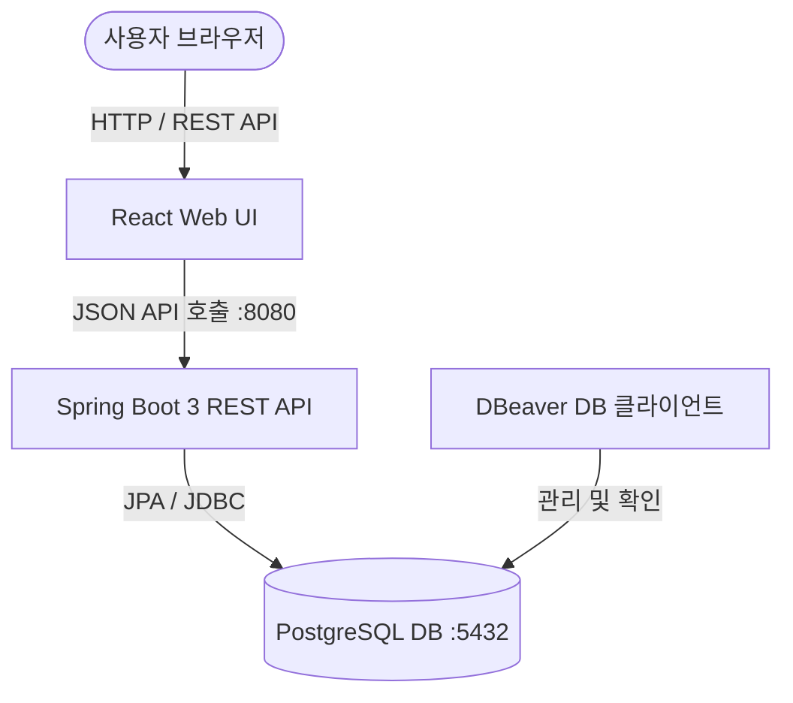
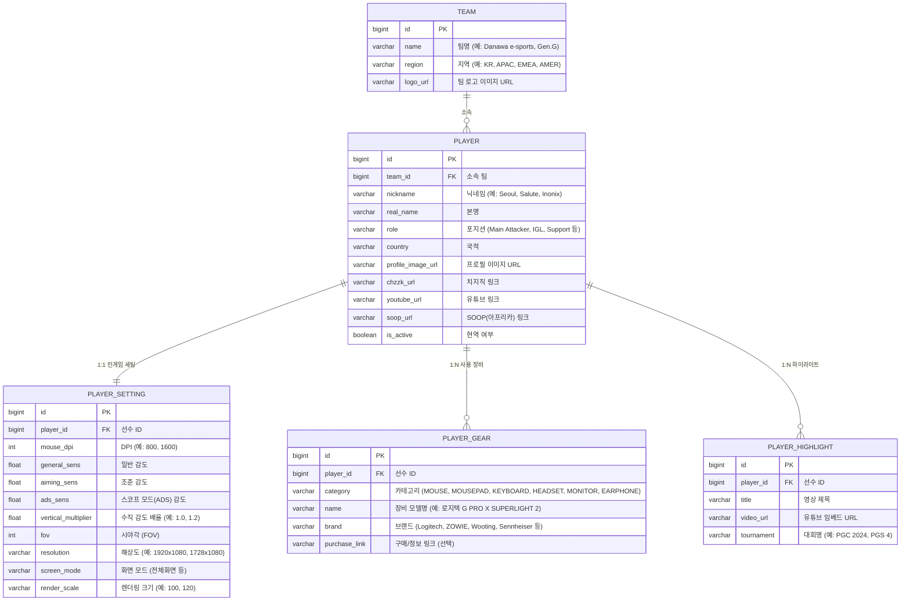

# PUBG eSports 선수 정보 & 세팅/기어 아카이브 구축 계획

배틀그라운드(PUBG) eSports 프로 선수들의 프로필, 인게임 세팅(감도/해상도/그래픽), 사용 장비(기어), 하이라이트 영상을 한눈에 탐색하고 검색할 수 있는 풀스택 웹 서비스를 구축합니다.

---

## 🏗️ 시스템 아키텍처 및 기술 스택

- **Backend**: Java 17/21, Spring Boot 3.x, Spring Data JPA, Spring Web, Lombok
- **Database**: PostgreSQL (Docker Compose로 컨테이너 구동)
- **Frontend**: React (Vite) + Vanilla CSS (게이밍 & e스포츠 특화 다크 네온 테마 UI)
- **DB Management**: DBeaver 연동용 포트 오픈 (기본 5432)
- **Deployment & Infra**: Docker Compose (DB + Backend + Frontend 통합 관리 가능)

---

## 🗄️ 데이터베이스 모델 설계 (ERD)

선수(Player)를 중심으로 팀, 세팅, 장비, 하이라이트 영상이 연결되는 구조입니다.

---

## 🚀 단계별 실행 계획

### [1단계] 개발 인프라 & 데이터베이스 구동 (Docker & DBeaver)
- `docker-compose.yml` 파일 작성 (PostgreSQL 16 컨테이너)
- Docker 실행 및 DBeaver로 접속 검증할 수 있는 가이드 제공

### [2단계] 백엔드 프로젝트 (Spring Boot 3) 초기 세팅
- Gradle 기반 Spring Boot 3 프로젝트 구조 생성
- JPA 엔티티 (`Player`, `Team`, `PlayerSetting`, `PlayerGear`, `PlayerHighlight`) 작성
- Repository, Service, REST Controller 구현
  - 선수 목록 조회 (팀별, 닉네임 검색, 정렬)
  - 선수 상세 조회 (프로필 + 세팅 + 장비 + 하이라이트 일괄 반환)
  - 팀 목록 및 장비 목록 조회
- 초기 시드 데이터(DB 초기 데이터) 자동 주입 (Seoul, Inonix, Salute, Heaven 등 실존 유명 프로선수 세팅 포함)

### [3단계] 프론트엔드 프로젝트 (React + Vite) 구축
- Vite 기반 React 프로젝트 세팅
- 프리미엄 e스포츠 다크/사이버펑크 감성 디자인 시스템 구축 (`index.css`)
  - 배그 특유의 옐로우/골드 + 네온 엑센트 + 딥 차콜/블랙 테마
- 주요 컴포넌트 개발:
  - **Header / Navigation**: 로고, 검색창, 팀별/지역별 필터
  - **Player Card Grid**: 선수 사진, 소속팀 로고, 닉네임, 주요 포지션, 빠른 스펙 엿보기
  - **Player Detail Modal / Page**: 
    - 🎯 **인게임 세팅 뷰어**: 감도 슬라이더 바, DPI, 해상도, FOV 시각화
    - 🎧 **기어 랙 (Gear Rack)**: 마우스, 패드, 키보드, 헤드셋 등 세련된 장비 카드
    - 🎬 **하이라이트 영상 플레이어**: 유튜브 임베드 영상 갤러리
  - **Search & Filter Bar**: 검색어 자동완성, 마우스 브랜드/팀 필터

### [4단계] 연동 및 통합 테스트
- 프론트엔드와 백엔드 API 연동
- 브라우저 동작 테스트 및 화면 반응형 검증

---

## 🔍 검증 계획

### 1. 백엔드 검증
- Docker DB 컨테이너 정상 구동 여부 확인
- Spring Boot 애플리케이션 실행 및 Swagger 또는 cURL로 `/api/players` REST API 응답 확인
- JPA 연관관계 매핑 및 DB 데이터 조회 정합성 검증

### 2. 프론트엔드 & UI 검증
- 브라우저 렌더링 확인 (선수 카드 목록 표시, 상세 정보 모달/페이지 열림)
- 검색 및 팀별 필터링 기능 동작 확인
- 모바일/데스크톱 반응형 레이아웃 확인
